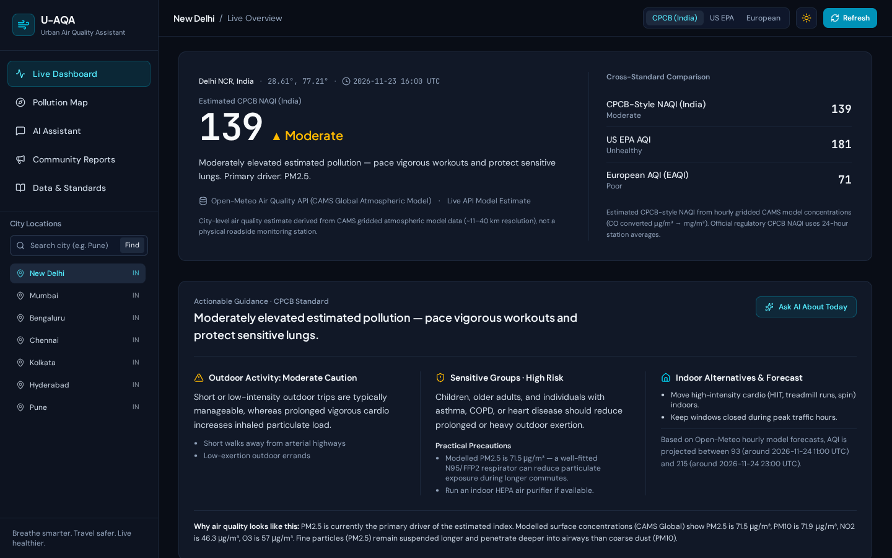
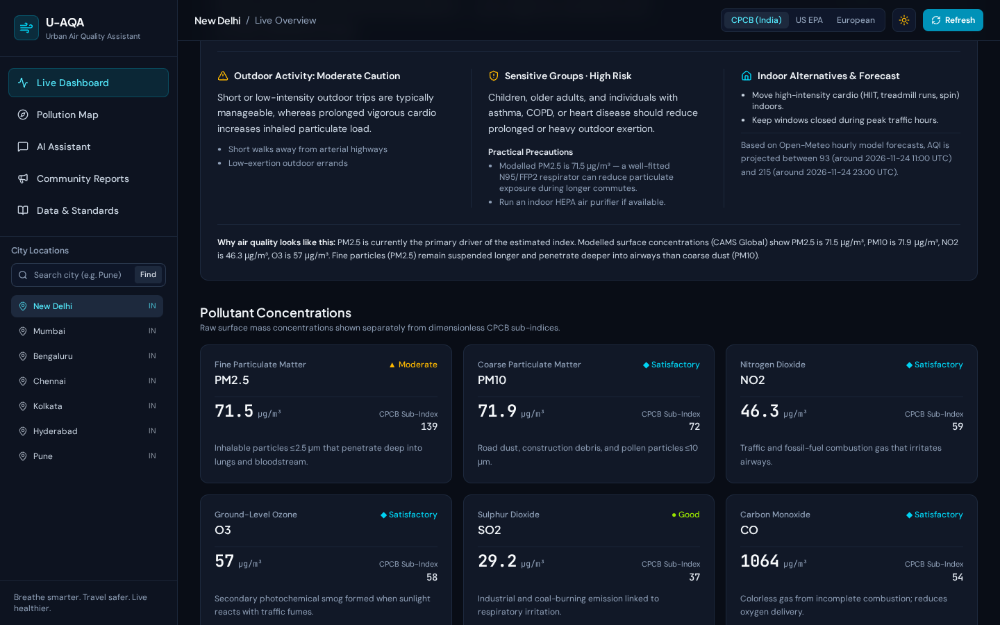
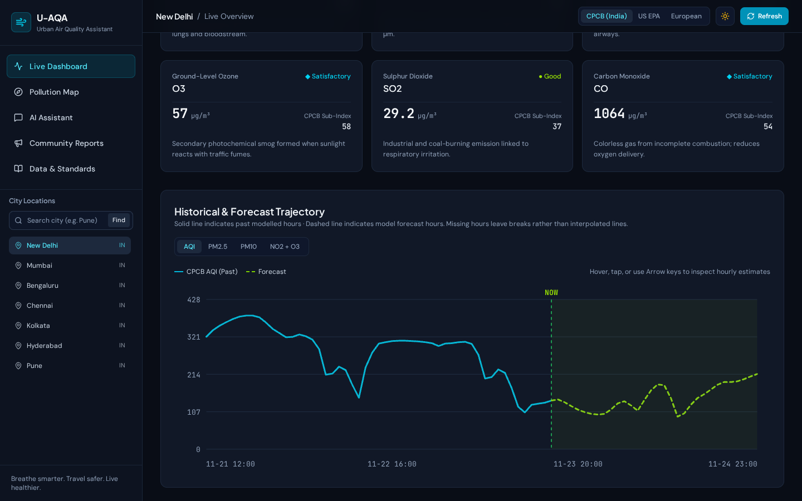
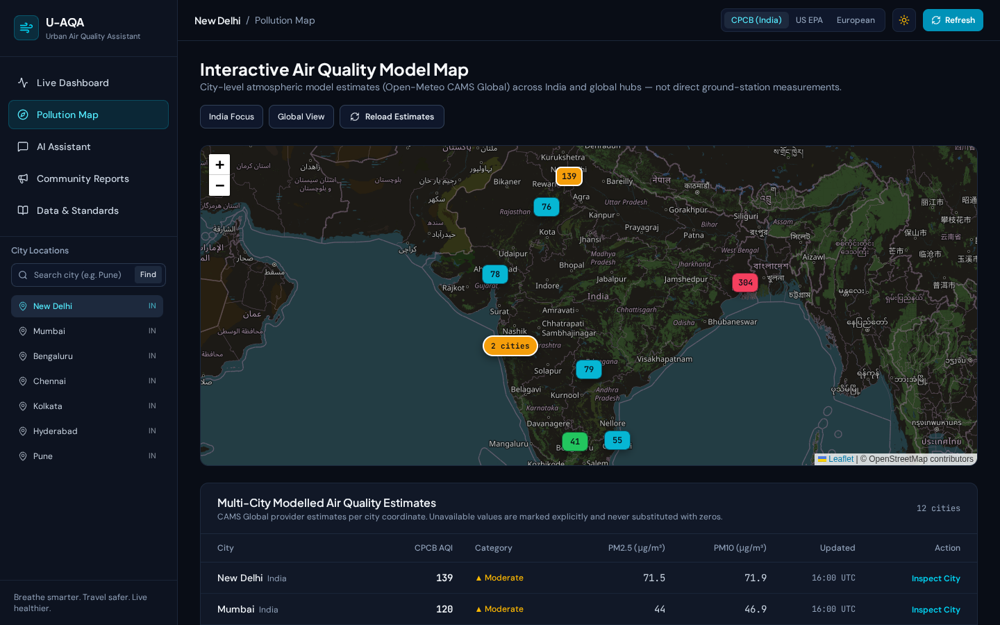
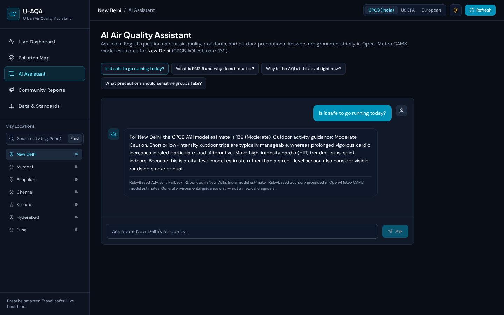

# Urban Air Quality Assistant (U-AQA)

**Breathe smarter. Travel safer. Live healthier.**

## Project Overview

Urban Air Quality Assistant (**U-AQA**) is a full-stack air quality intelligence web application designed to help city residents understand what pollutants they are breathing and make practical daily decisions around outdoor exercise, commuting, and respiratory protection.

Rather than displaying opaque numbers alone, U-AQA translates hourly gridded atmospheric model estimates (**Open-Meteo Air Quality API / Copernicus CAMS Global**) into clear Indian **CPCB-style NAQI**, **US EPA AQI**, and **European AQI (EAQI)** classifications, pollutant-by-pollutant health guidance, interactive spatial maps, historical/forecast trajectories, and a grounded conversational assistant.

Core principle: **Do not just show pollution. Help people act on it.**

---

## Screenshots of the Dashboard

### Live AQI Dashboard & Actionable Guidance


### Pollutant Concentrations (`μg/m³` vs. CPCB Sub-Index)


### Historical & Forecast Trajectory


### Interactive Pollution Map & Multi-City Comparison


### AI Air Quality Assistant


---

## Features

- **Live Multi-Standard AQI Dashboard**: Displays current city-level estimates for curated Indian and global hubs (plus any searched city worldwide via Open-Meteo Geocoding) across **CPCB-style NAQI (India)**, **US EPA AQI**, and **European AQI (EAQI)** without ever conflating scales.
- **Honest Pollutant Breakdown**: Tracks `PM2.5`, `PM10`, `NO2`, `O3`, `SO2`, and `CO`. Missing or invalid values are marked `Unavailable` (never coerced to `0`), raw mass concentrations (`μg/m³`) are separated from dimensionless sub-indices, and `CO` is normalized (`μg/m³ ÷ 1,000` to `mg/m³`) for CPCB 2014 breakpoint calculations.
- **Smart Recommendation Engine**: Generates cautious outdoor activity verdicts, sensitive-group risk assessments, indoor alternatives, practical precautions (e.g., N95/FFP2 masks during elevated PM2.5), and forecast range summaries.
- **Interactive Pollution Map**: Leaflet + OpenStreetMap view featuring zoom-aware screen-pixel marker clustering (preventing overlapping badges in dense metros like Mumbai/Pune), interactive city popups, and an accessible comparison table.
- **Historical & Forecast Trends**: Keyboard-accessible interactive SVG chart (`ArrowLeft` / `ArrowRight` / `Home` / `End`) separating historical modelled hours (solid cyan line), the `NOW` divider, and forecast hours (dashed lime line), leaving breaks across missing data points rather than interpolating.
- **Grounded AI Air Quality Assistant**: Server-side Gemini (`gemini-4-hydrogen` via `@google/genai`) assistant strictly grounded in the selected city's current model estimates, featuring prompt-boundary sanitization, a `10s` timeout guard, and an automatic deterministic rule-based fallback when `GEMINI_API_KEY` is unset.
- **Community Pollution Reporting**: SQLite-backed (`node:sqlite`) local observation form and feed for smoke, road dust, waste burning, and industrial plumes—validated, duplicate-throttled (`409` within 5 minutes), and labeled **Unverified citizen report** separately from atmospheric model estimates.
- **Security Hardening & Accessibility**: Dark-first UI with light theme toggle, non-color severity indicators (`●`, `◆`, `▲`, `■`, `⬢`), `helmet` CSP/HSTS headers, `express-rate-limit` per-endpoint throttling (`X-Forwarded-For` + RFC 7239 `Forwarded` aware), strict payload limits (`32kb`), and parameterized SQLite queries.

---

## Technology Stack

| Layer | Technologies |
|---|---|
| **Frontend** | React 19, TypeScript 7 (`strict`), Vite 8, Tailwind CSS v4, Lucide Icons, Leaflet |
| **Backend** | Node.js (`>=22.14.0`), Express 4, `tsx`, `dotenv` |
| **Database** | Built-in SQLite (`node:sqlite`, WAL mode, parameterized prepared statements) |
| **External APIs** | Open-Meteo Air Quality API (CAMS Global), Open-Meteo Geocoding API, OpenStreetMap Tiles |
| **AI Integration** | `@google/genai` (`gemini-4-hydrogen`) + server-side deterministic rule-based fallback |
| **Security** | `helmet` (CSP, Referrer-Policy, Permissions-Policy, HSTS), `express-rate-limit` |
| **Testing & QA** | Node test runner (`node:test`), `happy-dom`, `tsc --noEmit`, custom static hygiene script |

---

## Installation Instructions

### Prerequisites
- **Node.js `>=22.14.0`** (required for built-in `node:sqlite` and native TypeScript execution).
- **npm** (or **Bun** — `bun.lock` is also included).

### Steps

```bash
# 1. Clone or unpack the repository and enter the project directory
cd urban-air-quality-assistant

# 2. Install dependencies
npm install
```

---

## Environment Variable Setup

Create a local `.env` file from `.env.example`:

```bash
cp .env.example .env
```

| Variable | Required | Default | Description |
|---|---|---|---|
| `GEMINI_API_KEY` | No | *(empty)* | Server-side Google Gemini API key for AI Assistant responses. Kept strictly on the backend. When omitted, the assistant automatically uses the deterministic rule-based advisory fallback. |
| `APP_URL` | No | *(empty)* | Public base URL where the app is hosted (injected automatically in cloud preview environments). |
| `PORT` | No | `3000` | HTTP port bound by the Express + Vite server. |
| `TRUST_PROXY` | No | `1` | Reverse-proxy hop count for Express + rate limiting (`1` supports Cloud Run / Nginx `X-Forwarded-For` and `Forwarded` headers; set `0` or `false` if exposed directly without a proxy). |
| `DB_PATH` | No | `./data/uaqa.db` | Filesystem path for persistent SQLite storage (or `:memory:` for ephemeral test runs). |


---

## How to Run the Project

### Development Mode (Express API + Vite Middleware on Port 3000)

```bash
npm run dev
```

Open **`http://localhost:3000`** in your browser.

### Production Build & Start

```bash
npm run build
NODE_ENV=production npm start
```

> In containerized production deployments, attach persistent disk storage to `DB_PATH` (`./data/uaqa.db`) so cached model snapshots and community reports persist across restarts, and serve traffic behind an HTTPS reverse proxy.

### Typecheck, Static Hygiene & Automated Tests

```bash
npm run typecheck   # Strict TypeScript compiler check (tsc --noEmit)
npm run lint        # Typecheck + static security/hygiene scan (scripts/check-code.mjs)
npm test            # Runs all backend (server/uaqa.test.ts) & frontend (src/frontend.test.tsx) tests
```

---

## Known Limitations

1. **Spatial Resolution vs. Street-Level Sensors**: Open-Meteo's CAMS Global model provides regional grid estimates (~11 km to 40 km resolution) and captures background urban air quality well, but may miss hyper-local street-canyon diesel exhaust or localized open burning. All UI labels explicitly identify figures as model estimates rather than physical roadside monitoring stations.
2. **Hourly Estimates vs. 24-Hour Regulatory Averages**: Official Indian CPCB NAQI specifications compute PM2.5, PM10, NO2, and SO2 using 24-hour rolling station averages (8-hour for CO and O3). U-AQA computes an hourly model-derived estimate for real-time responsiveness.
3. **Unverified Citizen Observations**: Community pollution reports are stored with `verified = false` and displayed separately without altering modelled AQI values.
4. **AI Fallback Without Key**: If `GEMINI_API_KEY` is not configured or the upstream Gemini call fails/times out (`>10s`), `/api/assistant` transparently falls back to deterministic rule-based environmental guidance.
5. **Node 22 SQLite Experimental Notice**: Starting the server on Node 22 emits Node's standard `ExperimentalWarning: SQLite is an experimental feature` notice for `node:sqlite`.
6. **Cleaner Route Suggestions (Future Enhancement)**: Low-pollution street routing is intentionally documented as a future enhancement rather than simulated with synthetic corridors, as reliable street-by-street route scoring requires dense road-network sensor coverage and dedicated routing geometry APIs.
